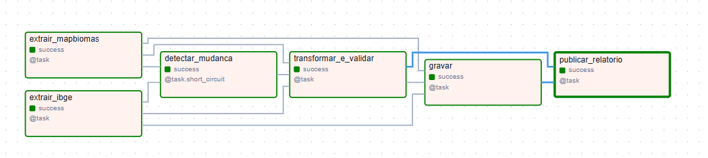

# Pipeline de atualização automatizada de bases territoriais

Projeto de engenharia de dados: uma rotina em **Airflow** que mantém atualizadas bases públicas e
geoespaciais — **IBGE** (malha municipal) e **MapBiomas** (cobertura e uso da terra) — com validação,
histórico de execuções, alertas de falha e uma página-resumo com mapa.

**Veja o resultado:** [relatório de exemplo (Pará)](https://raquelnsouza.github.io/territorial-data-pipeline/)

Executado com dados reais: 144 municípios do Pará, 80 mil linhas de cobertura do solo (MapBiomas Coleção 11,
1985–2025), com o arquivo grande baixado automaticamente do Google Drive a cada execução.

## O que ele faz

```
 IBGE (malha municipal) ─┐
 IBGE (nomes)            ├─► detecta mudança ─► trata + valida ─► grava ─► página-resumo
 MapBiomas (Drive)      ─┘     (checksum)        (regras)                  (mapa + histórico)
                                   │                  │                  │
                                   └──────────── auditoria (quando, de onde, o quê) ─────────┘
                                   Falhou? → registra + avisa por e-mail; o dado anterior é mantido.
```

Só reprocessa quando a fonte muda (comparação de checksum), então rodar toda semana não custa nada
quando não há novidade.



## O que o projeto cobre

| Tema | Onde está |
|---|---|
| Fontes, formatos e acesso (APIs do IBGE, planilha do MapBiomas no Drive) | `src/territorial/config.py` |
| **Qualidade dos dados**: projeção, geometrias, códigos, consistência entre as bases | `src/territorial/validate.py` |
| **Histórico de execuções**: o que foi baixado, validado e gravado, com SHA-256 do arquivo | tabelas `audit.*` / `audit/*.jsonl`; arquivo bruto preservado |
| **Atualização incremental**: agendamento semanal, só processa se a fonte mudou | `schedule="@weekly"` + checagem de checksum |
| **Padronização**: SIRGAS 2000, código IBGE de 7 dígitos, formato longo (município × ano × classe) | `src/territorial/transform.py` |
| **Arquivos grandes**: download do Drive, planilha de 78 MB lida em streaming, limpeza de disco | `extract.py`, `transform.py` |
| **Robustez a mudanças da fonte**: ZIP com a planilha dentro, colunas `y1985`, abas `COVERAGE_*` | `transform.py`, testes |
| **Alertas** de falha | `src/territorial/alerts.py` |
| **Testes** (unitários, integração com PostGIS, ponta a ponta) | `tests/` |
| Infraestrutura (Docker, HTTPS, usuário somente leitura) | `docker-compose.yml`, `Caddyfile`, `scripts/` |

## Modos de execução

O mesmo código roda de duas formas:

* **Airflow + arquivos** (`dags_local/`): sem Docker e sem banco. Saída em GeoPackage, relatório HTML e histórico em JSON.
  É o modo mais simples para testar e foi o executado com dados reais.
* **Airflow + PostGIS** (`dags/`): grava num banco geográfico com carga transacional (staging → troca), para
  uso com QGIS ou Power BI. Coberto por testes de integração com PostGIS real.

### Só Python no Windows

`scripts/rodar_local.ps1` roda o fluxo completo sem Airflow, com a saída em GeoPackage e relatório.

## Estrutura

```
dags/territorial_update_dag.py             fluxo com PostGIS (fino: só orquestra)
dags_local/territorial_update_local_dag.py fluxo em arquivos, sem banco
src/territorial/                           a lógica (testável sem Airflow)
  config.py extract.py transform.py validate.py load.py audit.py alerts.py report.py local_run.py
sql/init.sql                               tabelas, visão e auditoria
tests/                                     pytest + integração com PostGIS + ponta a ponta
scripts/                                   Airflow sem Docker, servidor, Windows, Codespaces
docs/                                      relatório publicado (GitHub Pages)
docker-compose.yml Dockerfile Caddyfile    Airflow + PostGIS + HTTPS
```

## Decisões de projeto

* **Lógica fora do DAG.** O DAG só orquestra; o que importa está em funções testadas.
* **Carga transacional com staging.** Grava em tabela temporária e troca numa transação; se falhar, a versão anterior fica.
* **Validação com severidade.** `ERRO` bloqueia a carga; `AVISO` (ex.: diferença de área entre as bases) entra no relatório mas não bloqueia.
* **Fonte bruta preservada.** Todo arquivo baixado fica guardado com checksum, com retenção das últimas versões.
* **Falhas visíveis.** Cada falha entra no histórico com a causa; o dado anterior não é sobrescrito.
* **Nova base = um extrator + um conjunto de regras**, sem mexer no resto.
